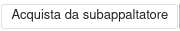
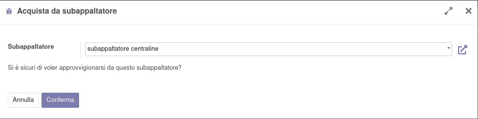
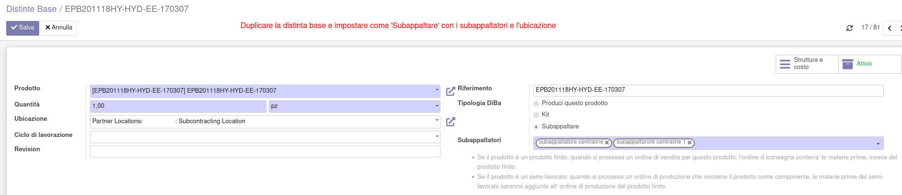
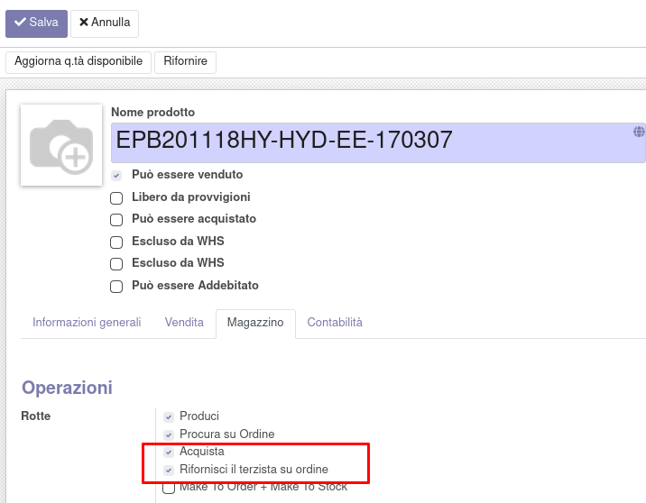
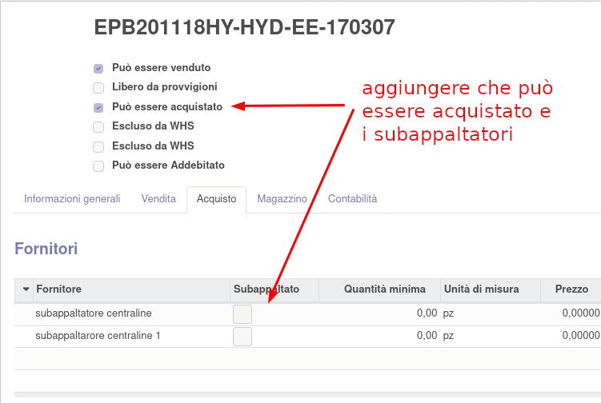
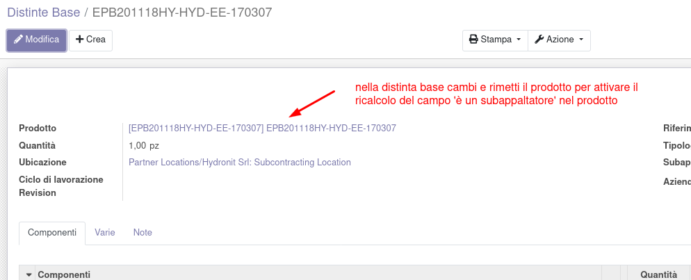
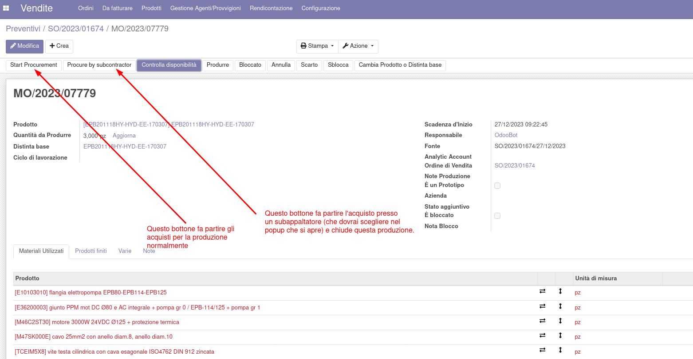
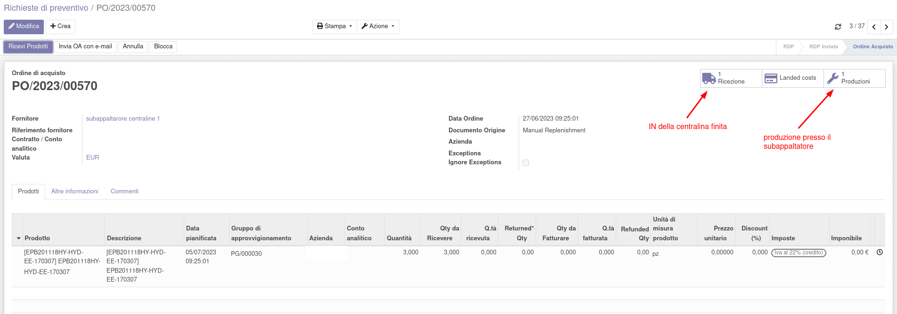
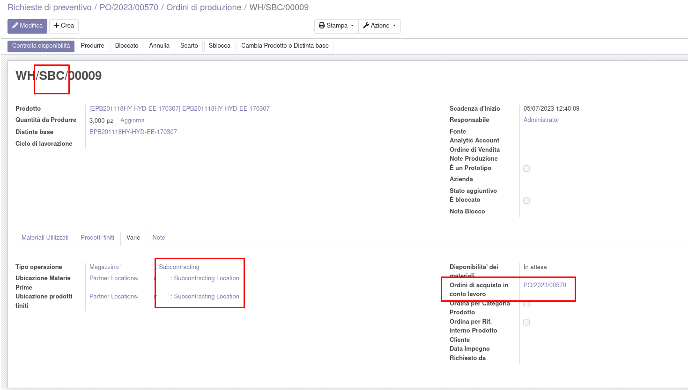

Questo modulo permette di scegliere se continuare la produzione creata
per un prodotto oppure rifornirlo presso un subappaltatore. Il prodotto
richiesto deve avere sia il percorso di produzione (con una priorità
superiore) che quello di acquisto (con una priorità inferiore), con una
distinta base di produzione e una di subappalto oppure con una sola
distinta di tipo subappalto con almeno due possibili subappaltatori.
Alla creazione della produzione di un prodotto che ha queste
caratteristiche non vengono più avviati gli approvvigionamenti dei
componenti.

Vengono quindi resi visibili due bottoni, che permettono, in
alternativa, di proseguire con la produzione o di fermare la produzione
e avviare l'acquisto presso un subappaltatore a scelta.

Il primo bottone permette di proseguire normalmente la produzione:

Il secondo bottone permette di scegliere un subappaltatore a cui
ordinare il prodotto, chiudendo contemporaneamente questa produzione:

Si apre quindi una procedura che permette di scegliere tra i possibili
subappaltatori. Alla conferma, la presente produzione sarà chiusa e sarà
generato un ordine d'acquisto e una produzione verso il subappaltatore
selezionato.

Nel caso ci siano prodotti subappaltati presso un singolo subappaltore,
l'ordine di acquisto generato viene automaticamente confermato, sia che
sia generato dalla rotta Procura su Ordine che da una regola di
riordino.

Il subappalto generato sarà quindi raggiungibile da un bottone sulla
produzione annullata:

È stato aggiunto un bottone per aprire i trasferimenti da fare verso il
subappaltatore direttamente dall'ordine di acquisto:

È stato inoltre aggiunto nel fornitore di un prodotto da acquistare
tramite subappalto la possibilità di decidere se l'RdP generato debba
essere o meno confermato automaticamente:

La tipica procedura da seguire per modificare un prodotto da produrre
internamente ad un prodotto che può avere entrambe le opzioni è:

