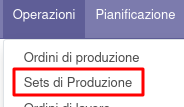

Questo modulo crea un oggetto Set di produzioni per collegare due
produzioni (oppure la stessa produzione vista come due) per inviarle in
maniera coordinata ad una macchina operatrice. La produzione di sinistra
sarà inviata al centro di lavoro che è impostato come "sinistro" mentre
quella di destra come "destro". È anche possibile inviare solo la
produzione di sinistra o la produzione di destra. N.B.: Possono essere
utilizzate solo produzioni con una BOM composta di un solo componente,
le altre non sono selezionabili dalla lista di produzioni da utilizzare.

Dal menu si crea un nuovo record:

in cui è possibile selezionare 2 distinte produzioni:

oppure 1 produzione e impostare il chech su "Suddividere la produzione"
(in questo caso la produzione occuperà entrambi i centri di lavoro):

oppure inviare la sola produzione destra o la sola produzione sinistra.

Se una delle produzioni selezionate è in stato "Bozza", è visibile il
bottone "Conferma" per confermarle:

Si può quindi procedere ad impostare la quantità da produrre delle
singole produzioni selezionate:

aggiornando la quantità nelle produzioni con il tasto "Aggiorna Q.tà in
Produzione":

È necessario quindi pianificare il set di produzioni, che andrà a
impostare la data di avvio sugli ordini di lavoro delle produzioni
collegate, verificando che siano correttamente impostati rispettivamente
sul lato sinistro e sul lato destro. Se è una produzione splittata, la
lavorazione verrà suddivisa su entrambi i centri di lavoro, creando un
duplicato dell'ordine di lavoro sul centro di lavoro collegato ad una
macchina operatrice sul banco non occupato (quindi destro se è occupato
il sinistro e viceversa). In questo modo è possibile vedere che entrambi
i banchi della macchina sono utilizzati e i relativi tempi.

È eventualmente possibile annullare la pianificazione e ripianificarla.

Si può infine inviare le produzioni al macchinario tramite il bottone
aggiunto dal connettore installato (attualmente l'unico modulo esistente
aggiunge il bottone sotto):

